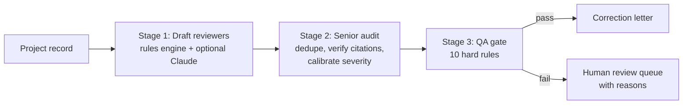

# Plan Review Copilot

Drafts building-plan correction comments, audits them like a senior plans examiner, and blocks weak ones before they reach an applicant.

**[▶ Live demo](https://frankaburamez.github.io/plan-review-copilot/)** · runs in the browser, no install


A three-stage pipeline that drafts building-plan correction comments, audits them the way a senior plans examiner would, and blocks weak comments before they reach an applicant. An evaluation harness scores it against an answer key.

Built by an ICC-certified building plans examiner who leads a 20+ engineer plan review operation, to explore how AI drafting can be made safe enough for code-compliance work.

**Try it in the browser:** use the live demo link above, or open [`docs/index.html`](docs/index.html) locally. Pick a project, change a door width or turn sprinklers off, and watch the three stages rerun. The browser version runs the same checks as the Python code.

> All projects in this repo are **fictional and synthetic**. No client, employer or jurisdiction data is used. Code sections are cited by number with paraphrased summaries; verify against the adopted code and local amendments.

## Why it's built this way

A correction letter is only useful if every comment is **actionable, cited, and right**. A single invented code section or brand-name requirement costs the reviewer credibility. So drafting is the easy part, and quality control is the product:



| Stage | What it does |
|---|---|
| **1. Draft** | A deterministic rules engine checks what the data can prove: occupant load (Table 1004.5), number of exits, exit separation, egress and stair width, door width, travel distance, corridor width, A-2 sprinkler triggers, postings, exit signs, and accessibility (accessible route from parking, accessible toilet rooms). An optional **Claude** reviewer (`--llm`) drafts additional findings as schema-validated JSON, restricted to the same verified section list. |
| **2. Senior audit** | Merges duplicates (keeping the higher severity), flags any citation not in the verified library, raises life-safety items (egress, sprinklers) to Critical, and caps paperwork items at Major. Every change is logged. |
| **3. QA gate** | Rejects any comment that has no citation or an unverified one, no sheet reference, no action verb, hedging ("might", "consider"), a product or model name, a quantitative claim without numbers, or an invalid severity. Rejected comments go to a human with the reasons attached. They are never silently dropped. |

## Results

`python -m evals.run_eval` (rules only, no API key needed):

| Metric | Result |
|---|---|
| Precision | **100%** (0 false positives across 8 projects, including one clean project) |
| Recall | **94%** (17 of 18 expected findings) |
| QA gate red team | **10/10** bad comments blocked, **4/4** good comments passed |

The one miss is accessible means of egress from an upper floor (§1009.1), which the rules engine doesn't model yet. That's the kind of gap the Claude reviewer is meant to fill, and why its output still has to pass the same audit and gate. Full table: [`evals/RESULTS.md`](evals/RESULTS.md).

How to read these numbers: the accessibility checks were added after the previous eval missed them, so P1–P6 are no longer a blind test. P7 and P8 were written afterward and score 2 of 3; the remaining miss (§1009.1) is left unmodeled on purpose. I wrote the answer keys myself, so treat this as a regression check, not a blind benchmark.

Sample output: [`examples/p2_bistro_letter.md`](examples/p2_bistro_letter.md).

## Run it

```bash
python -m unittest discover -s tests -t .          # 12 tests
python -m copilot data/projects/p2_bistro.json      # print a correction letter
python -m evals.run_eval --report evals/RESULTS.md  # score against the answer key

# Optional: add Claude as a second first-pass reviewer
pip install -r requirements.txt
export ANTHROPIC_API_KEY=...
python -m evals.run_eval --llm
```

No dependencies are needed for the rules-only mode. Python 3.10+.

## Repo map

```
copilot/rules.py         Stage 1 rules engine (each check shows its math in `evidence`)
copilot/llm_reviewer.py  Stage 1 Claude reviewer (structured JSON output, verified sections only)
copilot/senior_audit.py  Stage 2
copilot/qa_gate.py       Stage 3
copilot/code_refs.py     Verified section library and Table 1004.5 / 1017.2 values
data/projects/           8 synthetic projects, each with an answer key
docs/                    Browser demo (index.html + engine.js, a port of the Python pipeline)
tools/build_demo_data.py Regenerates docs/data.js from the Python sources
evals/                   Scoring harness + QA-gate red-team cases
```

## History

- **v1 (March 2026):** a Node.js rules checker for the Florida Building Code. It extracted text from plan PDFs, ran 21 checklist items and wrote a DOCX report. Keyword matching couldn't judge intent, and nothing checked its own output.
- **v2 (2026):** an LLM-drafted pipeline with a senior-audit stage and QA gate. It improved first-pass scenario results from 2/5 to 5/5. It isn't published, and this repo rebuilds it on synthetic data.
- **This repo:** the v2 architecture rebuilt end to end on synthetic data so it can be shown publicly and tested by anyone.
- **Oct 2026 update:** added accessibility checks (accessible route, accessible toilet rooms), two new test projects (a two-story office and a sprinklered warehouse), and a browser demo with a live QA-gate playground.

## Limits

- Inputs are structured project records, not plan PDFs. Sheet reading (OCR/vision) is out of scope here.
- Covers a slice of IBC 2021 Chapters 10–11 and §903. Local amendments (for example, California CBC Chapter 11B) are not modeled.
- Output is a draft for a licensed reviewer, not a code determination.
