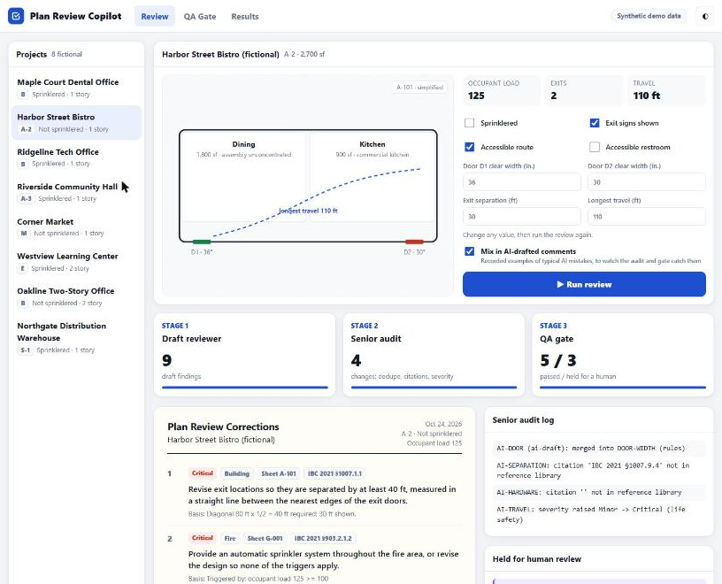
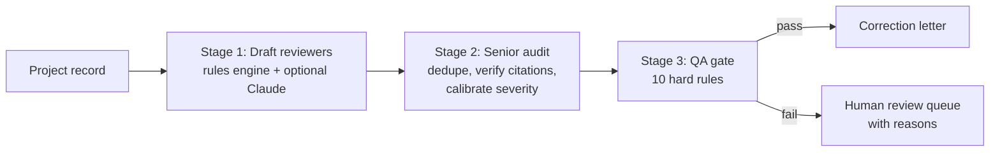

# Plan Review Copilot

Upload plans and calcs. Claude drafts the correction comments, a senior-audit stage calibrates them, and a QA gate blocks weak ones before they reach an applicant.

A personal learning project to test how AI review can be made safe, not a product.

**[▶ Live demo](https://frankaburamez.github.io/plan-review-copilot/)** · runs in the browser, no install



Built by an ICC-certified building plans examiner who leads a 20+ engineer plan review operation, to explore how AI drafting can be made safe enough for code-compliance work.

## What it does

- **New review.** Drop in plan sets and calculation PDFs, pick the code family (California, I-Codes or Florida) and disciplines. Dwellings and ADUs are reviewed under the residential code (CRC, IRC, FBC Residential), everything else under the building code. A pre-approved plan mode reviews only site-specific items and deviations from the approved set.
- **Recheck.** Upload the resubmittal with the earlier letter. Each previous comment is marked Cleared, Partly cleared, Not cleared or Cannot verify, with a follow-up comment for anything still open, and new unclouded changes are flagged.
- **Code checklist.** A required pass over the mandatory items (for a dwelling: fire separation, safety glazing, escape openings, smoke and CO alarms, sprinklers, landings, attic access, address, exhaust), each marked Complies, Not shown, Noncompliant or N/A, so a miss is visible instead of silent.
- **Every comment shows its sheet, code section, evidence and page.** Click the page chip to open the sheet.
- **Reviewer workspace.** Edit any comment, take it out of the letter, or move it between the letter and the held list. Add the plan check number, reviewer and jurisdiction.
- **Exports.** Copy, Word, print or PDF, and JSON. The review survives a page refresh.
- **Cost and speed.** Claude Sonnet 5.5 by default, with Claude Opus 5.5 as an option. A 20-sheet ADU set took about 4 to 5 minutes and about $0.70 in testing on public pre-approved plans.

The key goes only to Anthropic. It's saved in this browser only if you check Remember. Your files are also sent to Anthropic's API, so upload only plans you're authorized to share. Large sets may exceed per-request limits; review one discipline or one volume at a time.

Citations outside the built-in verified library are marked "verify citation" rather than blocked, because a real review cites the whole code. Every comment is a draft for a certified plans examiner to verify.

> The test projects in this repo are **fictional and synthetic**. No client, employer or jurisdiction data is used. Code sections are cited by number with paraphrased summaries; verify against the adopted code and local amendments.

## Why it's built this way

A correction letter is only useful if every comment is **actionable, cited, and right**. A single invented code section or brand-name requirement costs the reviewer credibility. So drafting is the easy part, and quality control is the product:



| Stage | What it does |
|---|---|
| **1. Draft** | A deterministic rules engine checks what the data can prove: occupant load (Table 1004.5), number of exits, exit separation, egress and stair width, door width, travel distance, corridor width, A-2 sprinkler triggers, postings, exit signs, and accessibility (accessible route from parking, accessible toilet rooms). An optional **Claude** reviewer (`--llm`) drafts additional findings as schema-validated JSON, restricted to the same verified section list. |
| **2. Senior audit** | Merges duplicates (keeping the higher severity), flags any citation not in the verified library, raises life-safety items (egress, sprinklers) to Critical, and caps paperwork items at Major. Every change is logged. |
| **3. QA gate** | Rejects any comment that has no citation or an unverified one, no sheet reference, no action verb, hedging ("might", "consider"), a product or model name, a quantitative claim without numbers, or an invalid severity. Rejected comments go to a human with the reasons attached. They are never silently dropped. |

## Results

`python -m evals.run_eval` (rules only, no API key needed):

| Metric | Result |
|---|---|
| Precision | **100%** (0 false positives across 8 projects, including one clean project) |
| Recall | **94%** (17 of 18 expected findings) |
| QA gate red team | **10/10** bad comments blocked, **4/4** good comments passed |

The one miss is accessible means of egress from an upper floor (§1009.1), which the rules engine doesn't model yet. That's the kind of gap the Claude reviewer is meant to fill, and why its output still has to pass the same audit and gate. Full table: [`evals/RESULTS.md`](evals/RESULTS.md).

How to read these numbers: the accessibility checks were added after the previous eval missed them, so P1–P6 are no longer a blind test. P7 and P8 were written afterward and score 2 of 3; the remaining miss (§1009.1) is left unmodeled on purpose. I wrote the answer keys myself, so treat this as a regression check, not a blind benchmark.

Sample output: [`examples/p2_bistro_letter.md`](examples/p2_bistro_letter.md).

## Run it

```bash
# Review real documents (needs ANTHROPIC_API_KEY or `ant auth login`)
pip install -r requirements.txt
python -m copilot review plans.pdf structural_calcs.pdf --code "2025 California codes" --out letter.md
python -m copilot review plans.pdf --code "2025 California codes" --standard-plan
python -m copilot recheck resubmittal.pdf --previous first_letter.md --code "2025 California codes"

# Rules engine and tests (no API key needed)
python -m unittest discover -s tests -t .          # 15 tests
python -m copilot data/projects/p2_bistro.json      # print a correction letter
python -m evals.run_eval --report evals/RESULTS.md  # score against the answer key

# Optional: add Claude as a second first-pass reviewer
pip install -r requirements.txt
export ANTHROPIC_API_KEY=...
python -m evals.run_eval --llm
```

No dependencies are needed for the rules-only mode. Python 3.10+.

## Repo map

```
copilot/rules.py         Stage 1 rules engine (each check shows its math in `evidence`)
copilot/doc_reviewer.py  Document review: plan/calc PDFs to Claude, structured comments out
copilot/doc_review_prompt.md  The reviewer instructions (shared by the CLI and the browser)
copilot/llm_reviewer.py  Claude reviewer for structured project records (verified sections only)
copilot/senior_audit.py  Stage 2
copilot/qa_gate.py       Stage 3
copilot/code_refs.py     Verified section library and Table 1004.5 / 1017.2 values
data/projects/           8 synthetic projects, each with an answer key
docs/                    Browser app (index.html, review.js for document review, engine.js = JS port of the audit and gate)
tools/build_demo_data.py Regenerates docs/data.js from the Python sources
evals/                   Scoring harness + QA-gate red-team cases
```

## History

- **v1 (March 2026):** a Node.js rules checker for the Florida Building Code. It extracted text from plan PDFs, ran 21 checklist items and wrote a DOCX report. Keyword matching couldn't judge intent, and nothing checked its own output.
- **v2 (2026):** an LLM-drafted pipeline with a senior-audit stage and QA gate. It improved first-pass scenario results from 2/5 to 5/5. It isn't published, and this repo rebuilds it on synthetic data.
- **This repo:** the v2 architecture rebuilt end to end on synthetic data so it can be shown publicly and tested by anyone.
- **Oct 2026 update:** added accessibility checks (accessible route, accessible toilet rooms), two new test projects (a two-story office and a sprinklered warehouse), and a browser demo with a live QA-gate playground.

## Limits

- Document review reads PDFs and sheet images through Claude. One request holds about 30 MB of files; split large plan sets by discipline.
- The rules engine and its eval use structured project records, not PDFs.
- Document review has not yet been validated on real plan sets. The precision and recall numbers apply to the rules engine on synthetic records.
- Covers a slice of IBC 2021 Chapters 10–11 and §903. Local amendments (for example, California CBC Chapter 11B) are not modeled.
- Output is a draft for a certified plans examiner, not a code determination.
